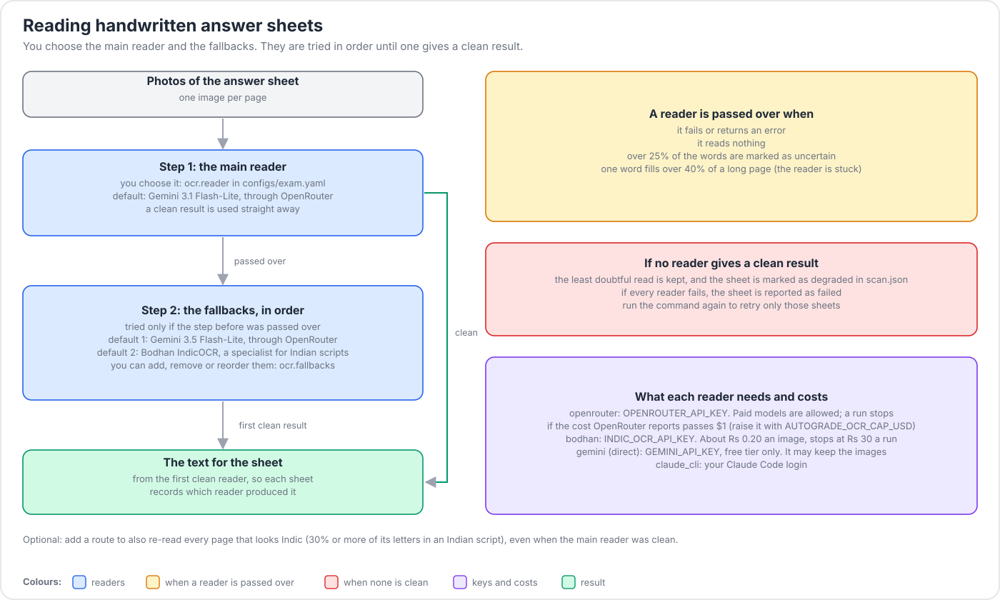
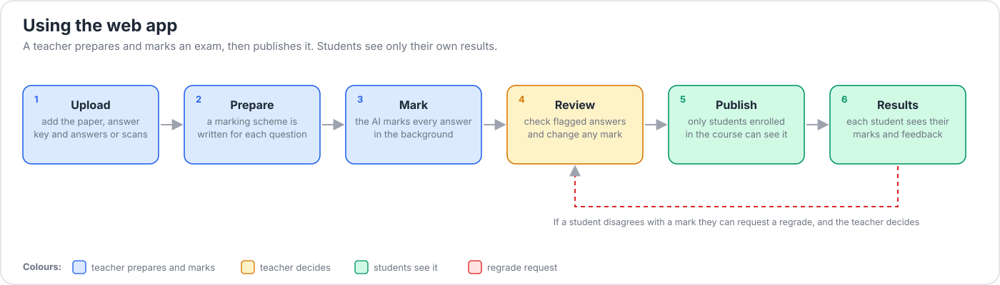
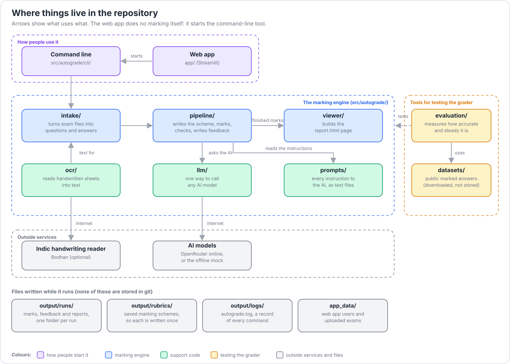

<div align="center">

# autograde

**Automatic marking of STEM answer sheets. Every mark comes with a quote from the student's own
words that proves it.**


*You give it the exam files. It writes a marking scheme, marks every answer point by point, checks
the marking with code, and writes feedback.*

</div>

## Table of contents

- [Why you can trust the marks](#why-you-can-trust-the-marks)
- [Features](#features)
- [Installation](#installation)
- [Quick start](#quick-start-no-api-key)
- [Usage](#usage): [real exam](#marking-a-real-exam), [handwriting](#reading-handwriting), [web app](#web-app)
- [Project structure](#project-structure)
- [Documentation](#documentation)
- [Current limitations](#current-limitations)
- [Data and credits](#data-and-credits)
- [Development](#development) and [License](#license)

## Why you can trust the marks

An AI model is good at judging whether an answer makes a point, and poor at arithmetic and
bookkeeping. So the two jobs are split:

| The AI model decides | Code decides |
|---|---|
| Does this answer make this point? (a verdict **and a quote**) | Whether the quote really is in the answer |
| What a good answer to this question contains (the marking scheme) | That marks add up and stay within limits |
| What feedback would help this student | Multiple choice, numbers with units, code syntax and tests |
| | What to do when a check fails: redo once, repair, or flag for a person |

Anything the code could not fully verify carries a **flag**, so a teacher knows where to look.

## Features

- **Marking schemes written once per question**, tested (the model answer must score full marks and
  a blank answer zero), then saved and reused.
- **Evidence-backed marks**: no quote, no credit.
- **Many question types**: short answer, essay, maths, multiple choice, numbers with units, code,
  and diagrams.
- **Feedback for every answer that lost marks**, written from the checked marking only.
- **Teacher controls**: strictness, how partial credit works, mark step, free-text notes and
  follow-through marking for multi-part questions. Exam-wide rules are read from the paper itself.
- **Handwriting**, including Indian scripts: photographed sheets are read with a chain of readers
  in a fixed [fallback order](#reading-handwriting), and each sheet's writer is identified and
  checked against the class list.
- **Several languages**: marks and feedback follow the language of the answer (tested on Hindi and
  Marathi).
- **One model gateway**: every AI call goes through **OpenRouter**, so one key reaches many models.
  An **offline `mock`** model lets everything run with no key.
- **Web app** for teachers (upload, mark, override, publish, regrade) and students (results,
  regrade requests).

## Installation

You need Python 3.11 or newer and [uv](https://docs.astral.sh/uv/).

```bash
git clone https://github.com/TheHawk1093/Auto_Assessment.git
cd Auto_Assessment
uv sync --all-extras          # creates .venv with everything, including the web app and test tools
cp .env.example .env          # only needed for real models; see "Marking a real exam"
uv run pytest                 # optional: the whole test suite runs offline
```

A smaller install for the command line only: `uv sync --no-dev`.

## Quick start (no API key)

This marks a small demo exam with the offline `mock` model:

```bash
uv run autograde --config configs/mock.yaml exam \
  --paper examples/exam_demo/paper.json \
  --reference examples/exam_demo/reference_model_only.json \
  --answers examples/exam_demo/answers --name demo
```

It writes a folder, `output/runs/demo/`:

| File | What it holds |
|---|---|
| `marks.csv` | One row per student, one column per question |
| `schemes.md` | The marking scheme written for each question |
| `students/<name>.md` | The marks and feedback each student receives |
| `results.jsonl` | Every verdict, quote and flag, for other tools |

`marks.csv` from this run:

```text
student,1,2a,2b,3,total
alice,0,2,3,3,8
bob,0,0,3,0,3
cara,2,0,3,0,5
```

and part of `students/alice.md`:

```markdown
## Question 2a: 2 / 2
What you did well: You wrote "Bandwidth-delay product is the link rate times the one-way delay...",
which covers: the amount of data in flight on the link.
```

> The `mock` model marks by counting shared words. It shows that the pipeline runs and it powers
> the tests, but it is **not** a real grader. Use a real model for real marking.

## Usage

### Marking a real exam

Put your key in `.env` (copy `.env.example`; the file is git-ignored). `configs/exam.yaml` is the
deployment config: every AI call goes through OpenRouter.

| Key in `.env` | Used for | Needed |
|---|---|---|
| `OPENROUTER_API_KEY` | Marking, marking schemes, feedback, and the Gemini readers for handwriting | yes |
| `INDIC_OCR_API_KEY` | Bodhan IndicOCR, a fallback reader for Indian scripts | only if you use it |

```bash
uv run autograde --config configs/exam.yaml exam \
  --paper paper.docx --reference reference.docx --answers answers/ \
  --name quiz1 --strictness moderate --note "units are required"
```

`--paper` and `--reference` accept txt, md, docx, text PDF or json. `--answers` is a folder with
one file per student, or a json file. To use a different model, change `llm.model` in the config
to any model id that OpenRouter lists. Every flag and setting is explained in
[docs/USAGE.md](docs/USAGE.md).

### Reading handwriting

`autograde scan` turns photographed answer sheets into text before marking. **You choose the main
reader and the fallbacks** in the `ocr:` block of `configs/exam.yaml`. The main reader goes first,
and the fallbacks are tried in order until one gives a clean result.

<p align="center"></p>

*Figure: the reader order. The legend at the bottom of the figure explains the colours.*

```yaml
ocr:
  reader: {provider: openrouter, model: "google/gemini-3.1-flash-lite"}   # the main reader
  fallbacks:                                                               # then, in order:
    - {provider: openrouter, model: "google/gemini-3.5-flash-lite"}
    - {provider: bodhan, model: "indic-ocr"}                               # Indian-script specialist
```

1. **The main reader goes first.** The default is Gemini 3.1 Flash-Lite through OpenRouter. It
   scored the best character error rate of the readers compared on the Indian-script tuning pages
   (14.4%, against 18.6% for Gemini 3.5 Flash-Lite, 24.9% for Claude Sonnet and 43% for Claude
   Haiku). Those tests called Gemini directly, not through OpenRouter.
2. **A reader is passed over** when it fails, reads nothing, marks more than 25% of the words as
   uncertain, or gets stuck repeating one word. The next fallback is then tried.
3. **If no reader is clean**, the least doubtful read is kept and the sheet is marked as degraded in
   `scan.json`. If every reader fails, the sheet is reported as failed, and running the command
   again retries only those sheets.

Each reader needs its own key in `.env`:

| Provider | Key | Cost |
|---|---|---|
| `openrouter` | `OPENROUTER_API_KEY` | Paid models are allowed. A run stops if the cost OpenRouter reports passes $1. Raise the limit with `AUTOGRADE_OCR_CAP_USD` |
| `bodhan` | `INDIC_OCR_API_KEY` | About Rs 0.20 an image, and a run stops at Rs 30 |

**Bodhan is a fallback here, and it is not measured.** This repository has no accuracy results for
it. It is last in the default chain, so it is only used when the Gemini readers fail or read
doubtfully. Copy the model name from the Bodhan console, because `indic-ocr` is a placeholder. If
every sheet in an exam is in an Indian script and Bodhan turns out to be better on your pages, make
it the main reader instead (`ocr.reader` with `provider: bodhan`).

There is also an optional `routes:` setting that re-reads every page that looks Indian-script
(30% or more of its letters), even when the main reader was clean. It is off by default. See
[docs/USAGE.md](docs/USAGE.md).

### Web app

```bash
uv run python -m app.services.demo seed      # optional: demo accounts and demo exams
uv run streamlit run app/main.py
```

The demo accounts are made up and are not real people. They all use the password `demo1234`, and
the administrator is `admin` / `admin`. Sign in as `teacher_1` to upload and mark an exam, and as
`student_A` to see results. Change these before putting the app on a network.

<p align="center"></p>

*Figure: what a teacher and a student do in the web app.* More detail:
[app/README.md](app/README.md) and [examples/README.md](examples/README.md).

## Project structure

<p align="center"></p>

*Figure: how the folders relate. The web app does no marking itself, it starts the command-line
tool.*

```text
src/autograde/       the package, laid out in the order of the marking flow
├── intake/          teacher files -> one item per student answer
├── pipeline/        scheme, read, grade, verify, feedback, code checks
├── llm/             one ask() interface for AI models: OpenRouter, and an offline mock
├── prompts/         every instruction sent to the AI, as text files
├── cli/             the `autograde` command
├── viewer/          builds report.html
├── evaluation/      tests of the grader itself (stress, robustness, revision, ...)
├── datasets/        loaders for public grading datasets
└── ocr/             handwriting reading
app/                 Streamlit web app (views / services / ui)
configs/             settings: default, exam, mock, poc, models/
examples/            small exams for the demo and tests
tests/               pytest suite, fully offline
tools/               WebAssembly sandbox for running student code
docs/                guide, usage, design, datasets, credits, workflow, diagrams
data/  output/  app_data/    your data and everything generated (git-ignored)
```

Every folder above has its own README. To follow one student answer through the code, read the
[codebase guide](docs/GUIDE.md).

## Documentation

| Read | To |
|---|---|
| [docs/GUIDE.md](docs/GUIDE.md) | Understand the code: the map, one answer end to end, how to extend it |
| [docs/USAGE.md](docs/USAGE.md) | Every command, flag and config setting |
| [docs/DESIGN.md](docs/DESIGN.md) | Why it is built this way, with measured evidence |
| [docs/WORKFLOW.md](docs/WORKFLOW.md) | The four stages in the workflow figure |
| [docs/DEMO_CASES.md](docs/DEMO_CASES.md) | The four demonstration cases |
| [docs/DATASETS.md](docs/DATASETS.md) | The public datasets used to measure the grader |

## Current limitations

- The offline `mock` model is only a stand-in. Mark quality depends on the real model you choose.
- The default reader (Gemini 3.1 Flash-Lite through OpenRouter) was measured on Indian-script
  pages only through Google's own API, and Bodhan was not measured at all. Compare a few pages with
  their text before relying on either.
- Student code runs in a WebAssembly sandbox with the standard library only. Code that imports
  other packages (for example numpy) is not run and is flagged.
- Flagged answers still need a person's eye. The marks stand without review, but the flags say
  where review is worth the time.
- The demo accounts and their shared password are for local trials only.

## Data and credits

No dataset or student data is stored in this repository. Public datasets are downloaded on demand
into `data/` and are used only to measure the grader. Each dataset keeps its own licence. Sources,
licences, how each set may be used and the citations are in
[docs/DATA_CREDITS.md](docs/DATA_CREDITS.md).

## Development

```bash
uv run pytest                                         # tests (offline)
uv run ruff check src tests app && uv run ruff format src tests app
python docs/images/build_diagrams.py                  # rebuild the diagrams
```

See [CONTRIBUTING.md](CONTRIBUTING.md). Data, output and secrets are never committed.

## License

[MIT](LICENSE). Datasets keep their own licences; see [docs/DATA_CREDITS.md](docs/DATA_CREDITS.md).
