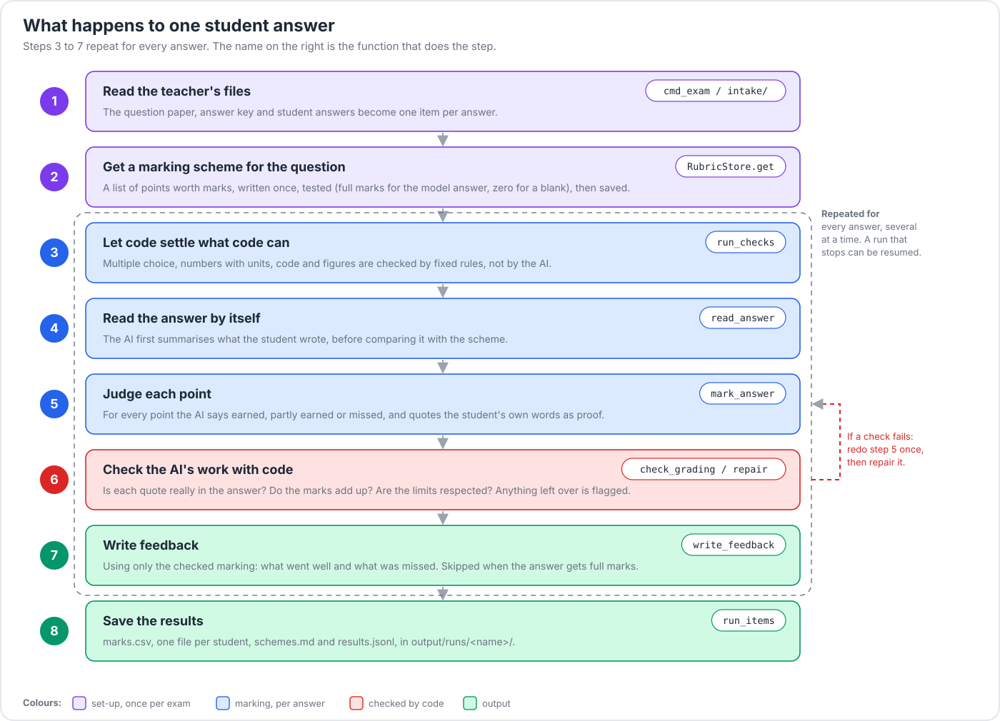

# Codebase guide

This guide explains how the code is organised and how one student answer travels through it. Read
the [README](../README.md) first. Each folder under `src/autograde/` also has a short README of its
own.

## 1. The main idea

An AI model is good at judging whether an answer makes a point. It is poor at arithmetic and
bookkeeping. So the project gives each job to the right tool:

- The **AI model** gives *judgements*: for each point in the marking scheme, did the student earn
  it, and which of the student's own words show it?
- **Code** does everything else. It turns the judgements into marks, checks that every quote
  really appears in the answer, enforces the limits, and settles multiple-choice questions,
  numbers and code with fixed rules. When a check fails, code asks for one retry, then repairs
  the result or flags it.

This split is the main design rule of the repository.

### Words used in this guide

| Word | Meaning |
|---|---|
| **Item** | One student's answer to one question, with its maximum mark and question type |
| **Scheme** (or **rubric**) | The list of points a question is worth, with the marks for each point |
| **Verdict** | The AI's decision on one scheme point: earned, partly earned or missed, with a quote |
| **Flag** | A note on a result saying that something could not be fully verified |
| **Backend** | One way of reaching an AI model, such as OpenRouter or the offline mock |
| **Run** | One marking job. Its files go in `output/runs/<name>/` |

## 2. Map of the repository

*Figure: where each folder sits and what uses what. The web app starts the command-line tool. It
never marks anything itself.*

| Path | Read it for |
|---|---|
| `src/autograde/schemas.py` | **Start here.** Every data structure: `Item`, `Question`, `Rubric`, `Grading`, `Feedback`, `Result` |
| `src/autograde/config.py` | The settings: `Settings`, `PipelineConfig`, `TeacherInputs`, `PathsConfig` |
| `src/autograde/pipeline/` | The marking steps ([README](../src/autograde/pipeline/README.md)) |
| `src/autograde/intake/` | Turning teacher files into items ([README](../src/autograde/intake/README.md)) |
| `src/autograde/llm/` | Reaching AI models ([README](../src/autograde/llm/README.md)) |
| `src/autograde/prompts/` | The instructions given to the AI ([README](../src/autograde/prompts/README.md)) |
| `src/autograde/cli/` | The commands ([README](../src/autograde/cli/README.md)) |
| `app/` | The Streamlit web app ([README](../app/README.md)) |
| `tests/` | The test suite ([README](../tests/README.md)) |

## 3. One answer, end to end

The command a teacher runs is `autograde exam`. The figure shows what happens to each answer, and
the function that does each step.

*Figure: the steps one answer goes through. The grey box marks the steps that repeat for every
answer.*

1. **Read the files.** `cmd_exam` (in `cli/exam.py`) reads the paper, the answer key and the
   student answers using `intake/`. This produces one `Item` per answer. Rules written in the paper,
   such as "show your working" or "answer any 4 of 5", are read by `intake/rules.py`. Flags that
   the teacher passes on the command line always override them.
2. **Get a marking scheme.** `RubricStore.get` (in `pipeline/rubric.py`) returns the scheme for a
   question. If a saved scheme exists it is reused. Otherwise one is written and **tested**: the
   model answer must score full marks and a blank answer must score zero. It is then saved in
   `output/rubrics/<client>/<variant>/`. Multiple-choice questions need no scheme.
3. **Mark one answer.** `run_items` (in `pipeline/run.py`) calls `grade_item` for every item,
   several at a time, and skips items that are already done, so an interrupted run can resume.
   `grade_item` calls `mark_item`, which does the following:
   - It runs the **code checks** for the question type (`pipeline/checks.py`, which uses
     `objective.py`, `numeric.py`, `codecheck.py` and `figure.py`). These give the AI facts to work
     from, and for some points they decide the mark themselves.
   - It calls `read_answer` (`read.py`) for a first pass over the answer on its own.
   - It calls `mark_answer` (`grade.py`), which asks the AI for a verdict on each point.
   - It checks the result with `verify.py` and applies the final rules (see the next step).
4. **Check the AI's work.** `verify.py` makes no AI calls. `check_grading` confirms that each
   quote is in the answer (text is compared after Unicode normalisation, which Indian scripts
   need), that the marks add up, and that no limit is broken. `apply_mark_rule` turns the verdicts
   into marks. If a check fails, the answer is marked once more. `repair` then fixes what is still
   wrong, and anything left over becomes a **flag**.
5. **Write feedback.** `write_feedback` (in `pipeline/feedback.py`) writes feedback from the
   checked marking only, for every answer that did not get full marks.
6. **Save the results.** Each answer's `Result` is added to `results.jsonl`. The command also
   writes `marks.csv`, `students/<student>.md` and `schemes.md` to `output/runs/<name>/`.

## 4. Data structures

Everything that passes between modules is a pydantic model defined in `schemas.py`. An `Item` (one
answer to one `Question`) is marked against a `Rubric` (made of `RubricPoint`s). That gives a
`Grading` (one `PointVerdict` per point) and a `Feedback`, and together they form a `Result`.

`Item.kind` is one of `short`, `essay`, `maths`, `mcq`, `numeric`, `code` or `diagram`. It decides
which code checks and which optional prompts apply. `LLMClient.ask` parses every AI reply into one
of these classes, so a malformed reply causes a retry instead of a hidden bug.

## 5. Settings and prompts

- A YAML file is loaded into `Settings` (`config.py`). Pass it with `--config`, **before** the
  command name. `configs/default.yaml` lists every switch with a comment.
- A switch such as `policy`, `feedback_variant` or `rubric_variant` selects a **prompt file** in
  `src/autograde/prompts/`. Changing behaviour usually means adding a prompt file and a switch in
  `PipelineConfig`, not adding a new code path.
- The teacher's controls (`strictness`, `partial_credit`, `mark_step`, notes and `follow_through`)
  live in `TeacherInputs` and are available as flags on the `exam` command.

## 6. Where files go

| Folder | Holds | Stored in git |
|---|---|---|
| `data/` | Input datasets and your own exam files | no |
| `output/runs/<name>/` | Marks, feedback and reports for one run | no |
| `output/rubrics/` | Saved marking schemes, per model | no |
| `output/logs/autograde.log` | A rotating log of every command | no |
| `app_data/` | The web app's database and uploaded exams | no |
| `examples/` | Small inputs for the demo and the tests | yes |

## 7. The web app

The `app/` folder has three layers:

- `views/` holds the Streamlit screens. They contain no logic.
- `services/` holds the logic (accounts, courses, publishing, grades, regrades, storage). It does
  not depend on the screens, and it is unit-tested.
- `ui/` holds shared widgets.

The app never marks anything itself. `services/jobs.py` starts `autograde exam` as a separate
process (through `jobwrap.py`) and reads the files it writes. This keeps the command line as the
single place where marking behaviour is defined. The marking settings are defined once, in
`services/settings_spec.py`, and become command-line flags. More detail is in
[app/README.md](../app/README.md).

## 8. How to change things

| I want to... | Do this |
|---|---|
| Add a model provider | Add a file in `llm/` that implements `_complete`, add a branch in `build_client`, and add the name to `Backend` |
| Change how answers are judged | Edit or add a file in `prompts/grade/`. If it should be optional, add a switch in `PipelineConfig` |
| Add a question type | Add it to `schemas.Kind`, write a check module like `numeric.py`, call it from `checks.py`, and add optional `grade.kind.<kind>` prompts |
| Add a teacher setting | Add a field to `TeacherInputs`, a flag in `cli/exam.py`, and an entry in `app/services/settings_spec.py` |
| Add a command | Add a module in `cli/` with a `register(sub)` function, and list it in `MODULES` |
| Add a screen | Add a file in `app/views/` and an entry in `app/main.py` |

Always add a test. Tests replace the AI with scripted replies (`tests/fakes.py`), so a new step is
tested by scripting what the AI would say.

## 9. Suggested reading order

1. `schemas.py`, then `config.py`
2. `pipeline/run.py` (`mark_item` and `grade_item`), then `grade.py` and `verify.py`
3. `pipeline/rubric.py`
4. `cli/exam.py` and `intake/exam.py`
5. `llm/base.py` and `llm/mock.py`
6. `app/services/jobs.py`

For the reasons behind the design and the measured results, see [DESIGN.md](DESIGN.md).

## 10. Conventions

- Python 3.11, with type hints and Google-style docstrings (ruff checks them).
- Pydantic models for data. No agent framework.
- Format and lint with `uv run ruff format src tests app` and `uv run ruff check src tests app`.
- Questions are split between `dev` and `test` data. Never tune on test data.
