# Workflow

The diagram source is [images/workflow.mmd](images/workflow.mmd) (Mermaid). Re-render with
`npx @mermaid-js/mermaid-cli -i docs/images/workflow.mmd -o docs/images/workflow.svg`.

## Stages

1. **Intake** (`intake/`). Reads the paper, the reference and the answers into `Item`s: question,
   model answer, student answer, max mark and question kind. Exam-wide rules (working required,
   part-mark rule, carry-through) come from the documents (`intake/rules.py`). `intake/identity.py`
   checks who wrote each sheet.
2. **Marking scheme** (`pipeline/rubric.py`). One scheme per question: points with marks and
   optional partial-credit levels. A self-test grades the model answer (must score full) and a
   non-answer (must score zero); a failing scheme is rewritten once. Schemes are cached in
   `rubrics/<client>/<variant>/`.
3. **Marking** (`pipeline/run.py`, per answer, in parallel).
   `checks.py` settles multiple choice, numbers and code facts by code; `read.py` reads the answer
   alone; `grade.py` gives per-point verdicts with quotes; `verify.py` confirms quotes are real,
   marks add up and forms are respected, with one retry and then repair. Doubtful answers can be
   re-marked by a stronger or second model (`cascade.py`, `vote.py`).
4. **Feedback and output** (`pipeline/feedback.py`, `viewer/`). Feedback is written from the
   verified marking only. Output: `schemes.md`, `marks.csv`, `students/*.md`, `report.html`.

Every model call goes through `llm/` (`ask(system, user, PydanticModel)`), so a backend can be
swapped, or replaced by the offline `mock`, without touching a stage.
